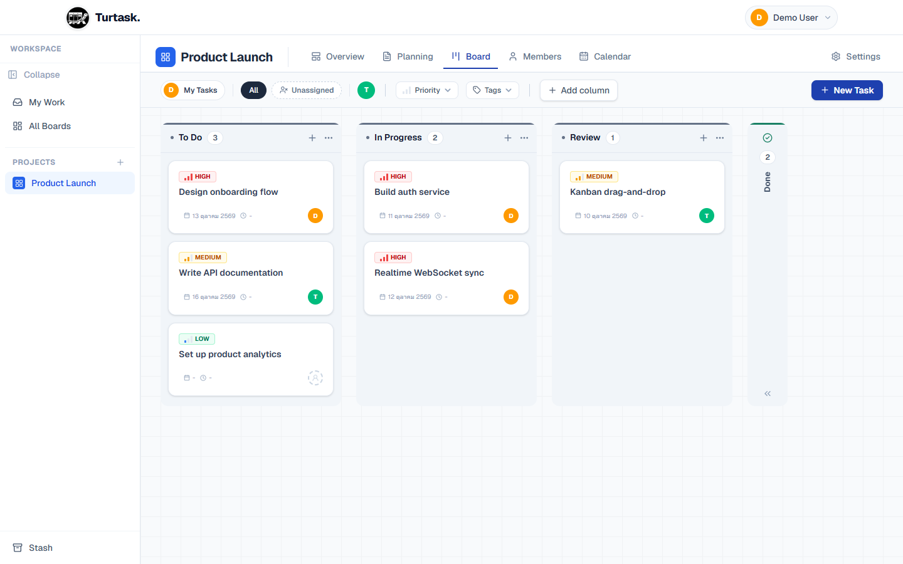
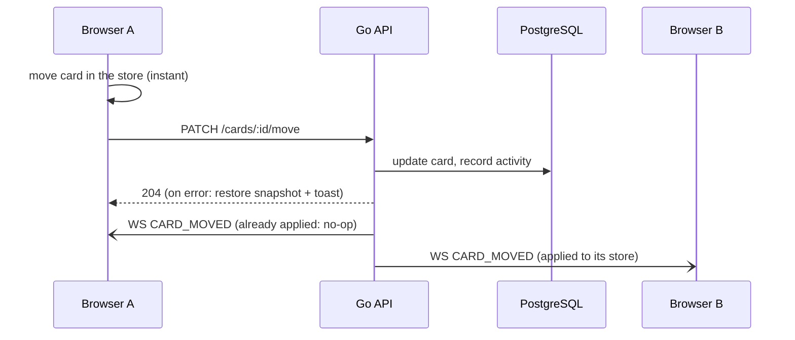
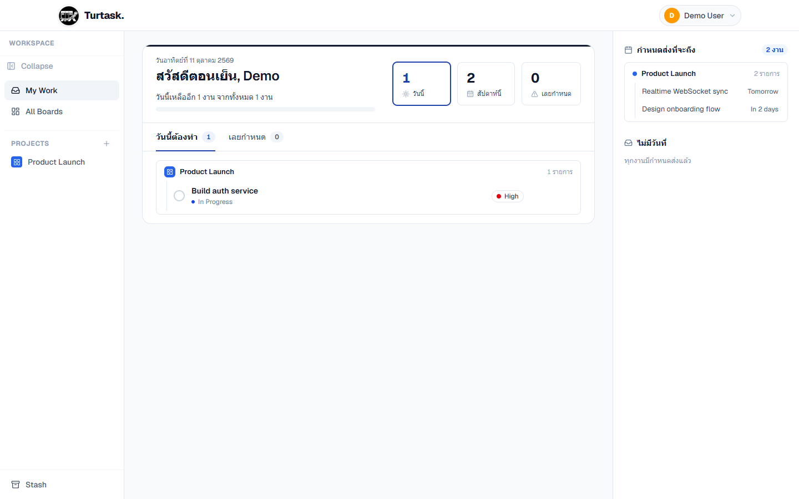
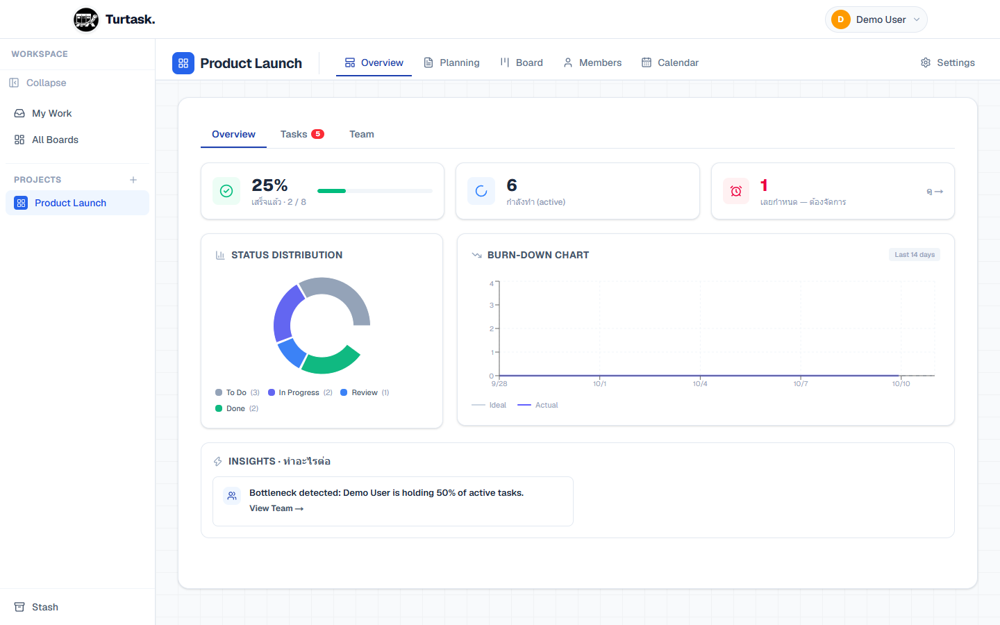
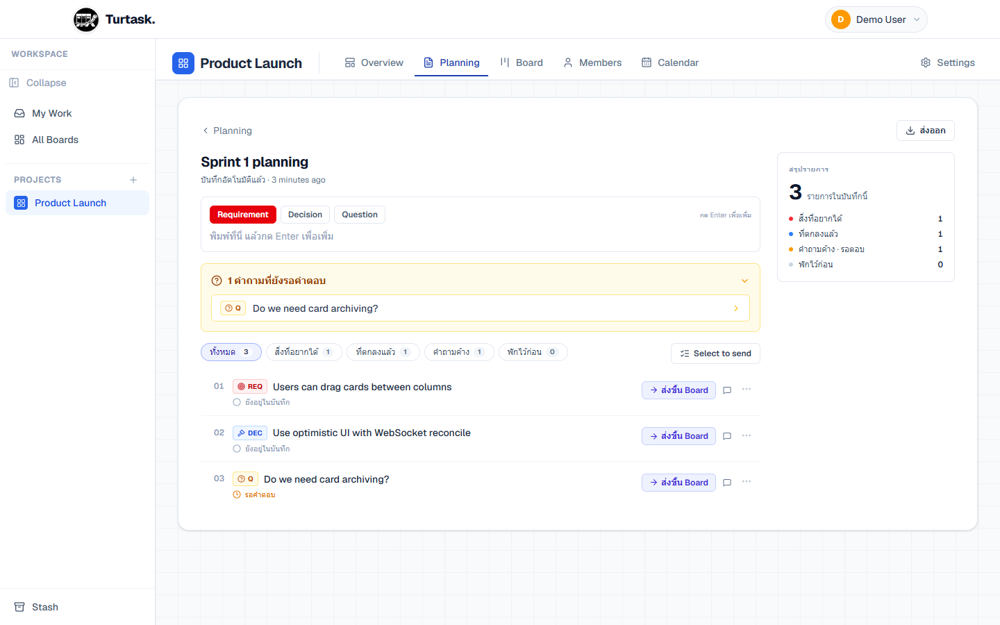
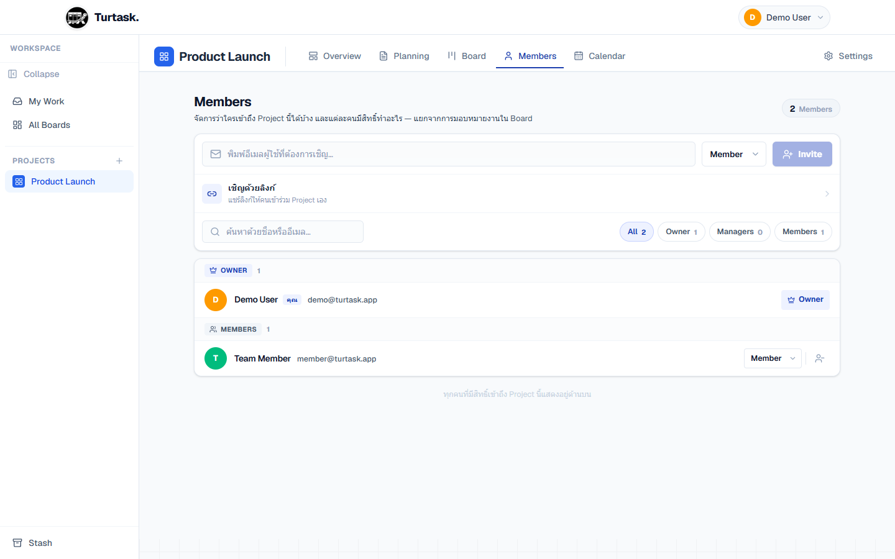

# Turtask — Mini ERP Kanban

[](https://github.com/aumputthipong/Kanban-management/actions/workflows/ci.yml)


[](LICENSE)
<!-- TODO: live demo badge (production URL not recorded in the repo) -->
<!-- TODO: CodeQL badge (no CodeQL workflow yet) -->
<!-- TODO: coverage badge (CI uploads coverage.out as an artifact but doesn't publish a %) -->

A real-time Kanban for small teams, built so that every teammate sees a card
move the moment it happens, without waiting on the server to feel fast.



## Try it

**Live:** <!-- TODO: production URL --> (free hosting: the first request after
a quiet spell can take about a minute while the API wakes up)

Click **Try demo** on the landing or sign-in page: you get a throwaway account
with a private copy of the sample board, deleted after 24 hours. Or sign in
with the shared account:

| Account | Email | Password |
|---|---|---|
| Shared demo | `demo@turtask.app` | `demodemo123` |

**Things worth trying**

- **Watch realtime sync:** open the same board in two windows and drag a card
  in one. It moves in the other without a refresh.
- **Feel the optimistic UI:** drag a card across columns. It lands before the
  server answers; if the server refuses, it snaps back with a toast.
- **Turn a note into work:** in **Planning**, jot a few notes, then send one
  to the board (ส่งขึ้น Board). It becomes a card in the To Do column.
- **Check your day:** **My Work** collects what's due today and overdue across
  every board; tick cards off in place, with undo.

## How a move reaches everyone



The sender also receives its own broadcast, so every WebSocket handler treats
"already in that state" as a no-op instead of filtering by sender.

## Tech stack

| Layer | Choice | Role here |
|---|---|---|
| Frontend | Next.js 16 (App Router), React 19, TypeScript strict | Pages and routing; a same-origin `/api` rewrite keeps the auth cookie first-party |
| Client state | Zustand | One board store that optimistic updates and WebSocket events both write to |
| Drag & drop | @dnd-kit | Card moves across and within columns |
| Styling | Tailwind CSS 4 | Tokens and rules in [frontend/design.md](frontend/design.md) |
| API | Go, chi | Thin handlers; permission checks and domain rules live in `service/` |
| Data | PostgreSQL 15, pgx/v5, sqlc, golang-migrate | SQL compiles to typed Go, so a renamed column is a compile error; migrations run on startup |
| Realtime | Gorilla WebSocket | One in-memory room per board |
| Auth | JWT access + opaque refresh token, Google OAuth | Sessions in HttpOnly cookies |
| Delivery | Docker, Vercel (frontend), Render (API), GitHub Actions | Lint, unit + integration tests and image builds on every PR |

## App shell

```
+-----------------+--------------------------------------------------------+
| Turtask         |  Board title                                           |
|-----------------|  Overview  Planning  Board  Members  Calendar  Settings|
| My Work         |--------------------------------------------------------|
| All Boards      |  To Do       | In Progress | Review      | Done        |
|                 |  [card]      | [card]      | [card]      | [card]      |
| PROJECTS     +  |  [card]      | [card]      |             |             |
|   Board A       |              |             |             |             |
|   Board B       |                                                        |
|                 |                                                        |
| Stash           |                                                        |
+-----------------+--------------------------------------------------------+
```

The sidebar collapses to icons.

<details>
<summary>Routes</summary>

```
/                               landing (signed-in users go to their default page)
/login, /register               sign in / sign up (email or Google)
/invite/:token                  join a board from an invite link
/my-work                        personal inbox: due today, overdue, upcoming, no date
/dashboard                      all boards
/stash                          stashed (archived) boards
/board/:id/overview             up next, team ownership, activity feed
/board/:id/planning             planning sessions (requirements, decisions, questions)
/board/:id/planning/:sessionId  one session: capture notes, comment, promote to card
/board/:id/tasks                the Kanban board (Board tab)
/board/:id/members              members, roles and invite link
/board/:id/calendar             cards by due date
/board/:id/settings             board settings
```

</details>

## Code worth reading

- **Optimistic updates with rollback.** Card actions snapshot the board,
  update the store, then call the API; a failure restores the snapshot and
  shows a toast ([`useCardActions`](frontend/src/hooks/useCardActions.ts),
  [`useDragActions`](frontend/src/hooks/useDragActions.ts)).
- **A WebSocket contract CI enforces.** Event names are declared once in Go
  and once in TypeScript; `make check-ws-events` fails the build if they drift
  or a raw string sneaks in ([ADR 0007](docs/adr/0007-ws-event-contract.md)).
- **WebSocket auth across two domains.** The cookie lives on the Vercel
  origin but the socket dials Render, so the page trades it for a short-lived
  ticket in the handshake URL ([ADR 0005](docs/adr/0005-websocket-ticket-auth.md)).
- **One error path for the whole app.** [`apiClient`](frontend/src/lib/apiClient.ts)
  turns 403 and 5xx into toasts itself, so call sites only handle what they
  can act on.

**Tested against a real Postgres** (testcontainers):
[`promote_integration_test.go`](backend/internal/service/promote_integration_test.go)
races concurrent promotes of one note and checks exactly one card appears;
[`refresh_rotation_integration_test.go`](backend/internal/service/refresh_rotation_integration_test.go)
checks a replayed refresh token kills the whole session.

More reasoning: [docs/CODE-NOTES.md](docs/CODE-NOTES.md) and the
[ADRs](docs/adr/).

## Screens

| My Work | Board overview |
|---|---|
|  |  |
| **Planning session** | **Members and roles** |
|  |  |

## Getting started

Needs Docker, Go 1.26+ and Node.js 20+.

```sh
docker compose up -d                                       # Postgres on :5432
cd backend && cp .env.example .env && go run ./cmd/api     # API on :8080, runs migrations

cd frontend                                                # second terminal, from the repo root
cp .env.example .env.local && npm install && npm run dev   # http://localhost:3000
```

**Try demo** works straight away. For the shared `demo@turtask.app` login, run
`cd backend && go run ./cmd/seed` once the API is up. Every variable is listed
in `backend/.env.example` and `frontend/.env.example`; API docs (Swagger UI)
are at <http://localhost:8080/docs/index.html>.

<!-- TODO: full-stack docker-compose.prod.yml is not documented here: in that setup the frontend container proxies /api to localhost:8080, which is itself, not the backend -->

<details>
<summary>Tests and code generation</summary>

| Task | Command |
|---|---|
| Everything CI runs | `make verify` |
| Backend tests / integration tests | `make test` / `make test-integration` |
| Frontend tests / type check / E2E | `make test-fe` / `make typecheck` / `make test-e2e` |
| Regenerate sqlc / OpenAPI | `make sqlc` / `make swag` |
| New migration | `make migrate-new name=add_x` |

</details>

## Production and security

- **Cookies, not localStorage:** both tokens are `HttpOnly` cookies; the
  refresh token is stored only as a hash, rotates on every use, and a replay
  revokes the session ([ADR 0001](docs/adr/0001-opaque-refresh-tokens.md)).
- **No third-party cookies:** the browser calls `/api` on the frontend origin
  and a Next.js rewrite proxies it to Render; WebSockets go over `wss://`.
- **Security headers** on every API response
  ([`security_headers.go`](backend/internal/middleware/security_headers.go)):
  `X-Frame-Options: DENY`, `nosniff`, `Referrer-Policy`, `Permissions-Policy`,
  and HSTS in production.
- **Rate limits** per client IP, resolved correctly behind the Vercel rewrite
  and Render proxy; creating a demo sandbox is capped at 5 per hour.
- **Roles enforced on the server.** Non-members get 404, not 403, so board IDs
  can't be probed ([ADR 0004](docs/adr/0004-membership-gate-returns-404.md)).

<!-- TODO: Content-Security-Policy is not set (neither on the API nor in next.config.ts) -->

The WebSocket hub and rate limiter keep state in memory, so production runs a
single API instance ([ADR 0003](docs/adr/0003-single-instance-websocket-hub.md)).
Deploy runbook: [docs/DEPLOY.md](docs/DEPLOY.md).

## Project layout

```
backend/     Go API: handlers, services, middleware, WebSocket hub, sqlc queries + migrations
frontend/    Next.js app: pages, components, Zustand stores, hooks
docs/        Architecture, database, deploy, code notes, ADRs
```

More detail: [docs/ARCHITECTURE.md](docs/ARCHITECTURE.md),
[docs/DATABASE.md](docs/DATABASE.md). Contributor rules: [AGENTS.md](AGENTS.md).
